# Исчерпывающее введение и обзор Gaussian Splats. Часть 1 — Введение

Автор: Chris Hanson
Опубликовано 9 августа 2024

AlphaPixel всегда следит за передним краем компьютерной графики и высокопроизводительных вычислений. В 2023 году дебютировала новая техника создания реалистичных сцен по разрозненному набору фотографий — Gaussian Splats (гауссовы сплаты).

Добро пожаловать в наше более чем исчерпывающее руководство по Gaussian Splats. Если вы читаете этот текст, то, скорее всего, уже слышали о Gaussian Splats, и у вас накопилась КУЧА вопросов. Что такое Gaussian Splats? Для чего они используются? Как их создают? Как их просматривают? Что такое сферические гармоники и как они применяются в Gaussian Splats? В чём преимущества и недостатки Gaussian Splats по сравнению с полигональной фотограмметрией и полями излучения (radiance fields) вроде NeRF? И кем вообще был Карл Фридрих Гаусс и почему это должно нас волновать? Ладно, последний вопрос вы, наверное, не задавали.

## Что такое Gaussian Splats?

Начнём с самого начала и объясним всё максимально подробно, не перегружая текст тяжёлой математикой и техническими деталями. Разберём словосочетание «Gaussian Splat» по частям и посмотрим, что означают эти слова вместе.

### Что такое сплаты (splats)?

Сплаттинг (splatting) уже много лет используется как техника рендеринга, в основном в области текстурирования. [Текстурный сплаттинг](https://en.wikipedia.org/wiki/Texture_splatting) (texture splatting) — это способ смешивания двух разных материалов на основе третьей, маскирующей текстуры смешивания.

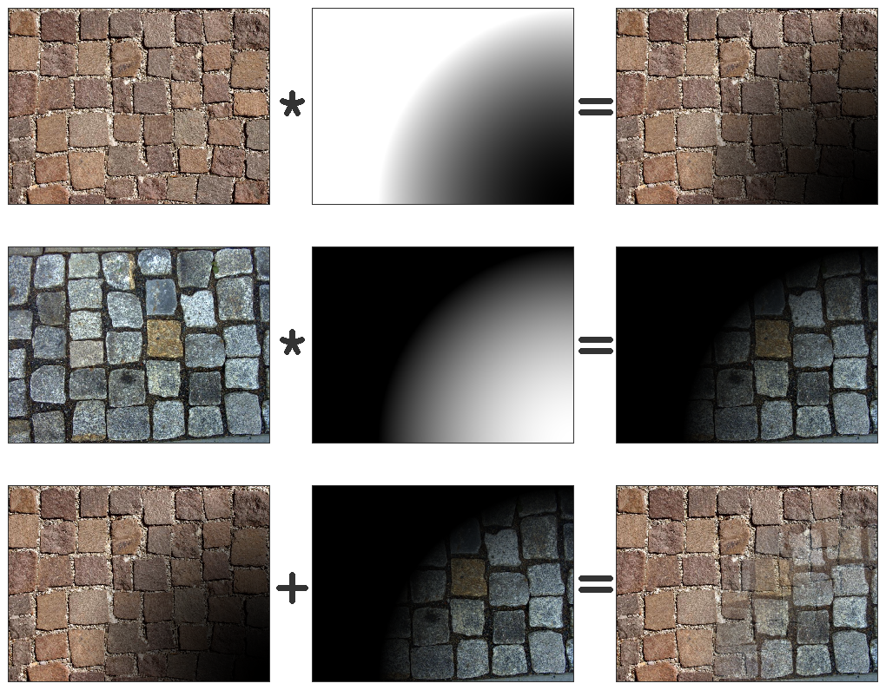
*Автор: [Simeon87](https://en.wikipedia.org/wiki/Texture_splatting#/media/File:Texture_splatting.png) — собственная работа, CC BY-SA 3.0, [commons.wikimedia.org/w/index.php?curid=4371291](https://commons.wikimedia.org/w/index.php?curid=4371291)*

### Что означает «Gaussian» (гауссов)?

Итак, «при чём тут гауссов» (перефразируя знаменитую строчку Тины Тёрнер «What's love got to do with it» — приносим ей извинения)?

[Википедия снова объясняет (с большим количеством математики)](https://en.wikipedia.org/wiki/Gaussian_function), что это функция, которая имеет малое значение по краям и округлый пик значения в середине. В 2D она образует аккуратное круглое размытое пятно значений в центре области влияния.

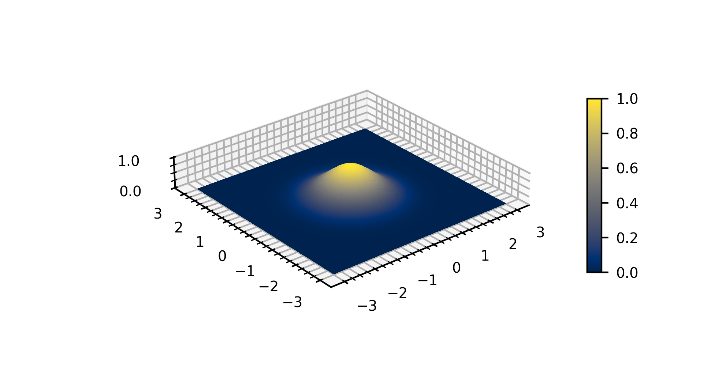
*Автор: [Kopak999](https://en.wikipedia.org/wiki/Gaussian_function#/media/File:Gaussian_2d_surface.png) — собственная работа, CC BY-SA 4.0, [commons.wikimedia.org/w/index.php?curid=97678049](https://commons.wikimedia.org/w/index.php?curid=97678049)*

## Gaussian Splats: объяснение

Итак, если сложить всё вместе: Gaussian Splat — это нечто, что смешивает текстуры с помощью гауссовой функции, модулирующей, где текстура есть, а где её нет. Это довольно точное описание тех точечных «капель» (blob), из которых состоит сцена Gaussian Splats. Одна отдельная 3D-гауссиана — это блоб сфероидной формы (её можно растягивать на разную величину по осям X, Y и Z), текстура которого наиболее непрозрачна в центре и постепенно исчезает к краям гауссианы. Что интересно, эта текстура представляет собой видозависимую сферическую гармонику (Spherical Harmonic) — то есть её внешний вид может меняться в зависимости от того, с какого направления на неё смотрят.

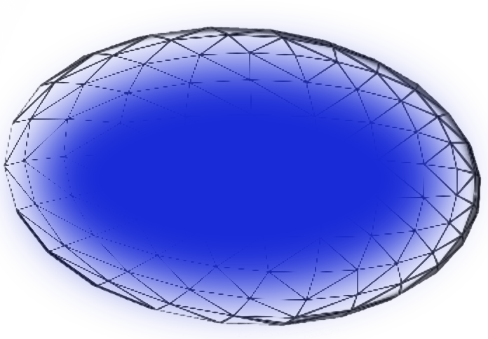
*3D-эллипсоидный сплат с одноцветной гауссовой текстурой, затухающей к краям. Автор: Chris Hanson.*

Итак, всё? Теперь вы понимаете про Gaussian Splats абсолютно всё? Ну да, конечно нет — это ещё далеко не всё. Например: а как мы вообще пришли к этой технологии?

Gaussian Splats — это новый способ рендеринга того, что раньше было известно как поле излучения (radiance field). Ничего принципиально нового в этом смысле. Поэтому сначала поговорим о полях излучения.

## Что такое поле излучения (radiance field)?

Поле излучения — это представление того, как свет взаимодействует со сценой: оно описывает, как свет исходит из каждой точки трёхмерного пространства. Оно фиксирует цвет и интенсивность света как функцию положения и направления, по сути детально описывая, как свет излучается, отражается или проходит через разные точки сцены.

В поле излучения с каждой точкой пространства связана информация о свете, зависящая от направления взгляда. Это позволяет рендерить реалистичные изображения, вычисляя, какой свет воспринимал бы наблюдатель с разных точек обзора. Поле излучения используется для создания фотореалистичных изображений за счёт точной симуляции освещения, теней и цветов объектов сцены с учётом взаимодействия источников света и материалов.

Поле излучения МОЖНО создать синтетически, трассируя лучи в сцене. Но один из самых увлекательных аспектов полей излучения — это их эмпирическое создание на основе данных, снятых в реальном мире. Алгоритмы анализа способны вывести структуру и содержимое полного поля излучения из разрозненных, редких «срезов» того, как излучение было зафиксировано в реальности. Сам термин «поле излучения» никак не определяет, каким именно способом поле создаётся из разреженных эмпирических данных, и не диктует, как именно его нужно рендерить, чтобы получить новые ракурсы, которых не было в исходных данных.

Наивным представлением поля излучения могла бы быть плотная, мелкая воксельная структура, где каждый воксель содержит нечто вроде lightprobe-изображения, показывающего, какой свет исходит из этой точки. Разумеется, такое представление было бы крайне **неэффективным**.

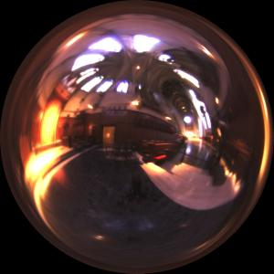
*Снимок lightprobe 1998 года, фиксирующий весь свет, падающий в одну точку собора Grace Cathedral в Сан-Франциско. Автор: Paul Debevec ([pauldebevec.com/Probes](https://www.pauldebevec.com/Probes/))*

До появления NeRF рендеринг полей излучения выполнялся путём построения множества локальных полей излучения с последующим смешиванием соседних полей для синтеза новых ракурсов.

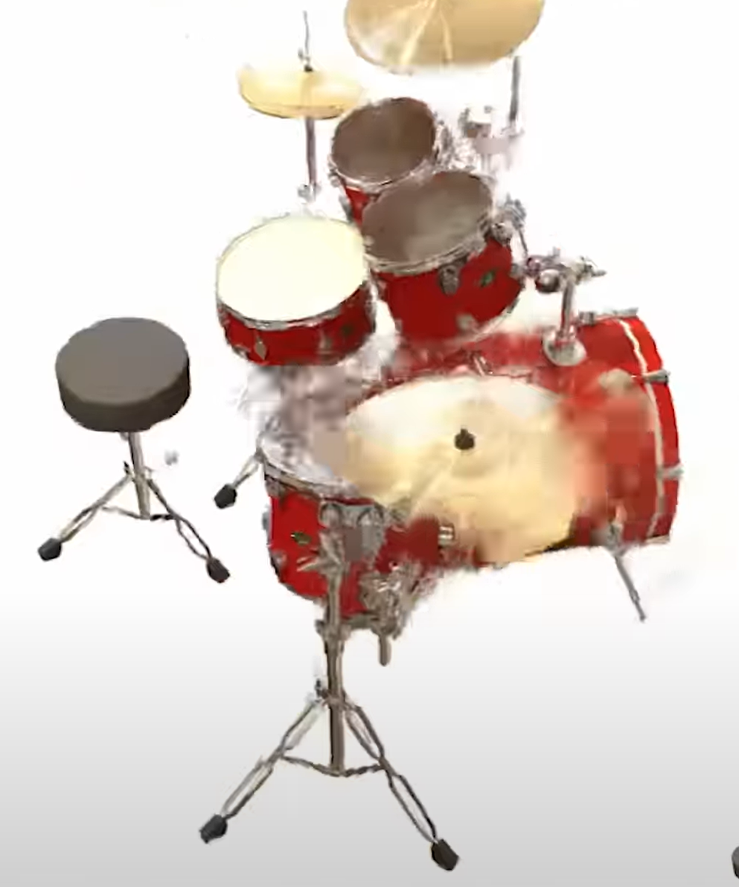
*Рендер поля излучения образца 2019 года, ещё до появления NeRF (LLFF, [bmild.github.io/llff](https://bmild.github.io/llff/)). Источник: [matthewtancik.com/nerf](https://www.matthewtancik.com/nerf)*

## Что такое нейронное поле излучения (Neural Radiance Field, NeRF)?

Появившиеся примерно в 2020 году [нейронные поля излучения](https://arxiv.org/abs/2003.08934) (Neural Radiance Fields; авторы — Ben Mildenhall, Pratul P. Srinivasan, Matthew Tancik, Jonathan T. Barron, Ravi Ramamoorthi, Ren Ng) — это реализация полей излучения, где рендеринг выполняется с помощью глубоких нейронных сетей. Процесс создания NeRF — это, по сути, процесс обучения нейронной сети. Обучение может быть довольно ресурсоёмким, и «единственно верного ответа» тут не существует. Можно бесконечно продолжать оптимизацию и обучение в поисках решения с лучшей метрикой ошибки, чем уже достигнутая, но в какой-то момент нужно остановиться и признать результат достаточно хорошим. Для передачи улучшений обратно в сеть используется обратное распространение ошибки (backpropagation).

Википедия поясняет: «Сеть предсказывает объёмную плотность и видозависимое излучаемое сияние (radiance) по заданному положению в пространстве (x, y, z) и направлению взгляда камеры в углах Эйлера (θ, Φ). Путём сэмплирования множества точек вдоль лучей камеры традиционные техники объёмного рендеринга способны построить изображение». То есть, по сути, вы подаёте на вход координаты XYZ и ориентацию луча, а сеть отвечает: «примерно столько-то света такого-то цвета придёт к вам вдоль этого луча» — почти как обычный, не нейросетевой, обратный [трассировщик лучей](https://en.wikipedia.org/wiki/Ray_tracing_(graphics)) (ray-tracer) или [ray-marcher](https://en.wikipedia.org/wiki/Ray_marching).

Однако вместо обычной тригонометрии для вычисления светового потока вдоль луча здесь приходится прогонять данные через глубокую нейронную сеть. Из-за этого техника может быть довольно медленной, даже на быстром GPU. С 2020 года было реализовано множество приёмов для оптимизации этой задачи и ускорения как самого рендеринга, так и процесса обучения, но NeRF всё равно остаются достаточно медленными. Кроме того, как и другие генеративные нейросетевые техники, они способны «галлюцинировать» данные: если для конкретного ракурса реальных данных нет, сеть может домыслить некие вымышленные (правдоподобные или не очень) данные. Это может быть как полезно, так и вредно — с одной стороны, помогает восполнить недостающие данные, с другой — может порождать артефакты и аномалии.

«Секретный ингредиент», превративший локальные поля излучения в NeRF, — это идея о том, что концепция единого целостного поля излучения сама по себе очень сложна («колючая»). Вместо того чтобы решать задачу методом слияния множества локальных световых полей, можно построить [дифференцируемую](https://en.wikipedia.org/wiki/Differentiable_function) модель с [метрикой ошибки](https://en.wikipedia.org/wiki/Error_metric). А затем бросить на эту задачу много вычислительной мощности, позволив машинному обучению нащупывать путь вперёд с помощью [градиентного спуска](https://en.wikipedia.org/wiki/Gradient_descent) (gradient descent), пока не найдётся приемлемое единое решение.

[Репозиторий кода к статье о NeRF 2020 года на GitHub — здесь](https://github.com/bmild/nerf).

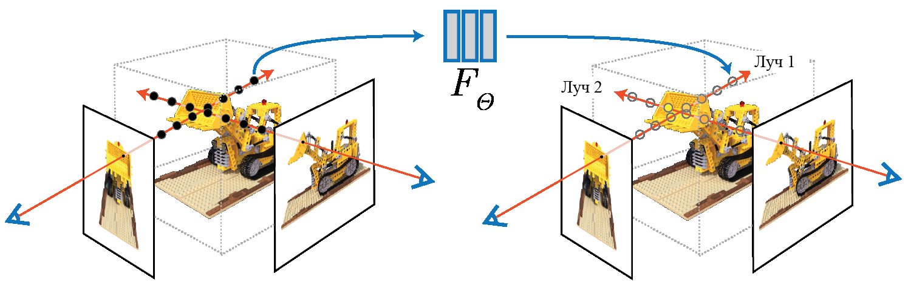
*Трассировка лучей в нейронном поле излучения (NeRF) игрушечного бульдозера из конструктора Lego. Источник: [Representing Scenes as Neural Radiance Fields for View Synthesis](https://www.matthewtancik.com/nerf)*

## Хорошо, а что такое фотограмметрия — для сравнения?

Фотограмметрия — это родственная техника, появившаяся ещё до NeRF и Gaussian Splats. Как и в случае с NeRF и Gaussian Splats, здесь берётся множество снимков сцены с разных ракурсов, и на их основе восстанавливается представление сцены. Делается это путём сопоставления положений и ориентаций камер, поиска общих видимых признаков (features) и обратного проецирования координат пикселей в реальное пространство — чтобы определить, где именно должен находиться признак, чтобы быть видимым в тех местах кадра, где он был замечен.

Процесс фотограмметрии был [разработан довольно давно](https://lumenandforge.com/photogrammetry-history-and-modern-uses/), но по-настоящему раскрылся при создании карт по аэрофотоснимкам в эпоху Первой мировой войны. Многие контурные (горизонтальные) карты Геологической службы США создавались хорошо одетыми мужчинами, стоявшими за фотограмметрическими столами и подстраивавшими фокус и совмещение двух аэрофотоснимков до тех пор, пока в фокусе и совмещении не оказывалась только узкая полоса определённой высоты, — после чего контур этой высоты обводился на карте. См. [DEVELOPMENT OF PHOTOGRAMMETRY IN THE U. S. GEOLOGICAL SURVEY, стр. 7](https://pubs.usgs.gov/circ/0218_1958/report.pdf).

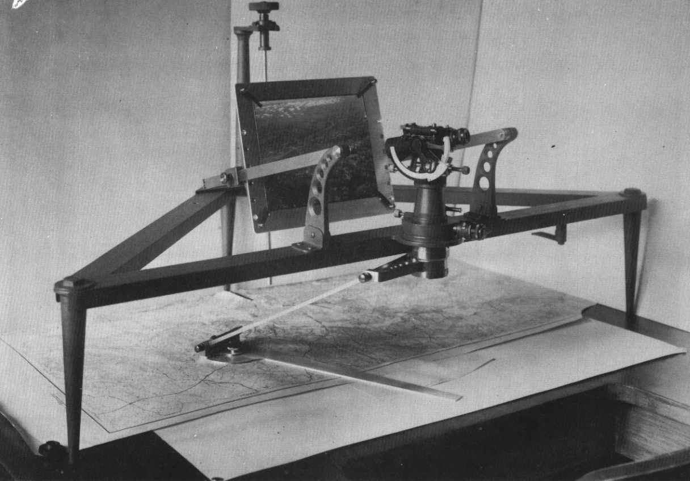
*Фотоалидада Wilson образца 1932 года, использовавшаяся для обводки горизонталей в фотограмметрии. [USGS](https://pubs.usgs.gov/circ/0218_1958/report.pdf)*

В современную цифровую эпоху компьютерная фотограмметрия выявляет общие признаки по всей сцене с помощью методов векторного описания признаков вроде SIFT или SURF, а затем сравнивает признаки, видимые на каждом снимке, чтобы найти совпадающие. Эти общие признаки объединяются с априорными знаниями о камере и объективе (часто на основе [EXIF](https://en.wikipedia.org/wiki/Exif)-данных цифровых фотографий в сочетании со справочной базой данных камер и объективов), чтобы вычислить, где находилась камера в момент съёмки каждого кадра, а затем — где перед камерами располагался каждый найденный признак. В результате создаётся «разреженное облако точек» (sparse point cloud), состоящее из многих тысяч точек сцены, которые удалось сопоставить на достаточном количестве ракурсов камеры, чтобы предсказать их положение в реальном мире. Каждой такой точке также присваивается один цвет (на основе статистического анализа всех цветов, которые она, по всей видимости, имела на разных исходных снимках). Этот процесс сегодня часто называют Structure-from-Motion (SfM, «структура из движения»), поскольку он часто выполняется на кадрах видео с движущихся камер и выводит структуру геометрии сцены из побочных эффектов многоракурсности движущейся камеры.

После создания разреженного облака точек выполняется процесс «денсификации» (densification), который пытается вывести дополнительные совпадающие цветные точки между уже имеющимися разреженными точками. На этом этапе можно получить уплотнённое (плотное) облако точек, а затем провести дальнейшую работу по группировке точек, лежащих в одной плоскости, в грани, которые далее превращаются в треугольные полигоны — каждый со своим небольшим растровым фрагментом текстуры. Это называется триангуляцией и текстурированием.

Такие полигоны, как правило, непрозрачны и имеют чёткие края — они создаются только там, где алгоритмы с высокой вероятностью «уверены», что в этом месте в реальности находилась твёрдая материя. Если полигоны создаются в местах с не такой высокой вероятностью, сцена, как правило, заполняется рваными, «шипастыми» мусорными полигонами, которые мешают и выглядят некрасиво. Минус в том, что разреженная геометрия — например, органические структуры вроде растительности или волос, а также такие материалы, как металл и стекло — плохо переживают процесс фотограмметрии и триангуляции.

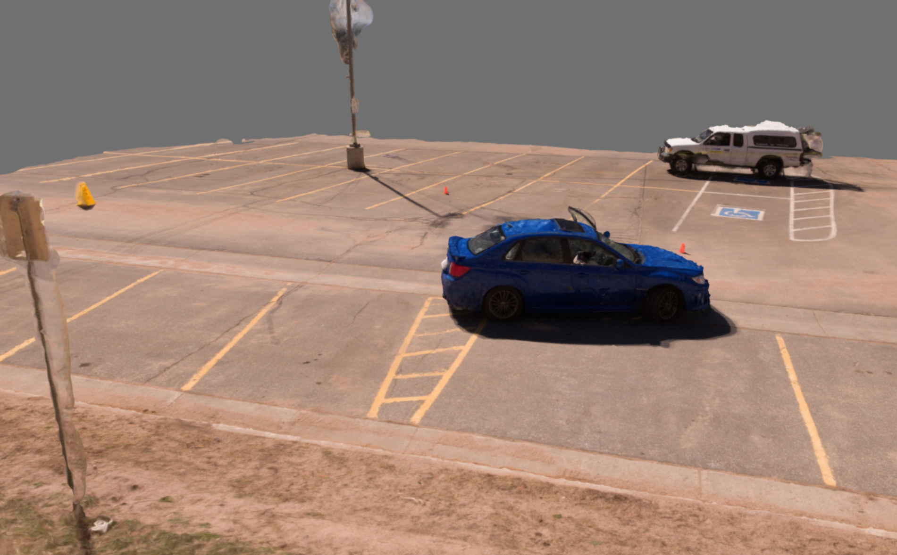
*Результат полигональной фотограмметрии. Обратите внимание на проблемы с тонкими или прозрачными объектами. Автор: Chris Hanson*

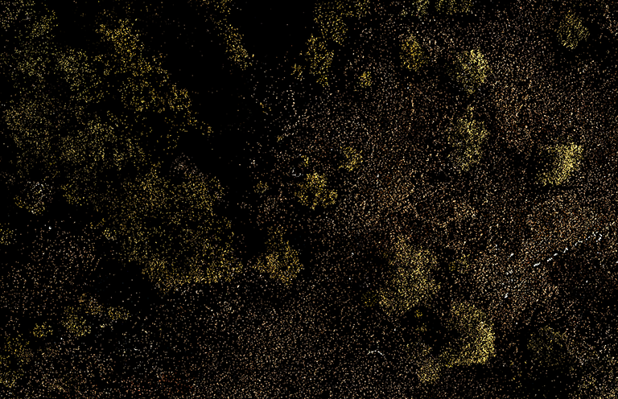
*Плотное облако точек леса, вид сверху. Автор: Chris Hanson.*

Фотограмметрия МОЖЕТ давать ОЧЕНЬ хорошие результаты при правильных, пусть и ограниченных условиях. В геопространственной сфере существует огромное количество 3D-объектов (например, 3D-модели зданий или ассеты в магазинах игровых движков), тщательно созданных с помощью фотограмметрии и обладающих отличным качеством.

## Что такое Gaussian Splats и зачем их изобрели?

Как любит повторять Молния Маккуин (Lightning McQueen) — *Скорость*.

NeRF рендерится путём выполнения глубокой нейронной сети. Хотя этот процесс ДЕЙСТВИТЕЛЬНО ускоряется GPU, он всё равно остаётся довольно медленным. Несмотря на то что оптимизации постоянно изобретались, в 2023 году несколько человек из INRIA (Национальный институт исследований в области цифровых наук и технологий, Франция) предложили новый подход (статья INRIA на SIGGRAPH 2023 «[3D Gaussian Splatting for Real-Time Radiance Field Rendering](https://repo-sam.inria.fr/fungraph/3d-gaussian-splatting/)») к вычислению и хранению поля излучения без использования полноценной глубокой нейросети. Идея заключалась в том, чтобы использовать оптимизацию градиентным спуском — точно так же, как при обучении нейронной сети, — но вместо запуска сети применять распространённый и быстрый метод (растеризацию Gaussian Splats) для укладки излучения в пиксели.

Чтобы реализовать трюк с видозависимым внешним видом, каждый такой сплат текстурируется представлением излучения (цвета и интенсивности света), исходящего из этой точки, в виде сферической гармоники. Оба этих приёма НАМНОГО эффективнее, чем тяжеловесный прогон через глубокую нейросеть, и их легко реализовать на языках фрагментных GPU-шейдеров вроде OpenGL/GLSL, HLSL и подобных. Эта техника может задействовать высокопроизводительные графические конвейеры, уже до предела отточенные и оптимизированные индустриями игр и визуальных симуляторов.

[Репозиторий кода Gaussian Splats от INRIA (SIGGRAPH 2023) на GitHub — здесь](https://github.com/graphdeco-inria/gaussian-splatting).

«Секретный ингредиент» Gaussian Splats возник из осознания того, что растеризационный рендеринг поля излучения тоже можно сделать дифференцируемым. *Дифференцируемость* — ключевое условие для того, чтобы, используя метрику ошибки, распространять изменения (вычисленные градиентным спуском) обратно в модель. Но вместо того, чтобы с помощью градиентного спуска настраивать глубокую нейросеть, которую затем выполнял бы ray-marcher для рендеринга, процесс обучения Gaussian Splats использует довольно простые геометрические операции над уже существующими сплатами (разбиение, слияние, масштабирование и т. д.) для настройки намного более простого представления сцены. Никакая нейросеть не нужна — когда настройка завершена, сплаты можно просто растеризовать!

Позже мы подробнее поговорим о том, как именно вычисляются/обучаются Gaussian Splats, — сегодня для этого существует уже немало техник.

С лета 2023 года исследования и разработки в области технологии Gaussian Splats стремительно продвигаются вперёд.

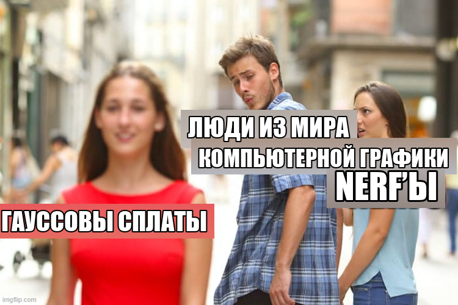

## Gaussian Splatting против NeRF

Gaussian Splatting очень часто сравнивают с его непосредственным предшественником — NeRF.

Gaussian Splats дают значительное преимущество перед NeRF в скорости рендеринга и простоте. Gaussian Splatting достигает производительности реального времени, представляя сцену в виде набора эффективно растеризуемых 3D-гауссиан. Это устраняет необходимость в сложных нейросетях и снижает вычислительные накладные расходы, делая технологию более подходящей для приложений, требующих быстрого взаимодействия в реальном времени. Простота Gaussian Splats повышает интерпретируемость и упрощает реализацию по сравнению со сложными многослойными перцептронами, используемыми в NeRF. Рендерер Gaussian Splats вполне можно написать на JavaScript и WebGL вообще без какого-либо нейросетевого кода.

Впрочем, есть у Gaussian Splats и недостатки. Дискретная природа Gaussian Splats может приводить к артефактам — например, к заострённым формам эллипсоидов, — если оптимизация выполнена недостаточно аккуратно. Этот метод требует тщательной инициализации и регуляризации, чтобы избежать проблем с недостаточной или избыточной реконструкцией. NeRF же, напротив, выигрывает за счёт непрерывного представления, которое обеспечивают нейросети: оно естественным образом сглаживает несоответствия и обеспечивает более устойчивую обработку сложных сцен, особенно в областях с разреженными данными.

Обе техники позволяют захватывать видозависимое излучение, что даёт возможность передавать прозрачность, отражения и даже преломление.

## Gaussian Splatting против фотограмметрии

Gaussian Splatting также принято сравнивать с фотограмметрией — основной техникой, использовавшейся до NeRF и по сей день остающейся вполне жизнеспособным и практичным графическим процессом.

Как уже объяснялось выше, Gaussian Splats используют набор 3D-гауссиан для представления сцены, что позволяет выполнять рендеринг в реальном времени за счёт эффективных техник растеризации. Этот метод особенно хорош в приложениях, требующих быстрой обработки и простой реализации, поскольку избавляет от необходимости строить сложные меши.

В противоположность этому полигональная фотограмметрия с текстурированием опирается на детальное построение меша и наложение текстур по фотографическим данным, обеспечивая весьма реалистичные и визуально насыщенные представления — идеальные для приложений, где на первом месте стоит визуальная достоверность твёрдых объёмов, таких как виртуальные туры и архитектурная визуализация. Кроме того, фотограмметрия создаёт сцену, которую можно анализировать геометрически. На полигональных мешах легко считается физика и коллизии, а сами меши можно очистить и подготовить для 3D-печати.

Техника Gaussian Splats также испытывает трудности со сценами, требующими непрерывных, гладких поверхностей, поскольку работает с дискретными точками. Полигональная фотограмметрия с текстурированием способна при определённых условиях давать отличное визуальное качество для некоторых типов моделей, но у неё отсутствуют видозависимые визуальные свойства, поэтому материалы, обладающие полупрозрачностью/прозрачностью, отражением или преломлением, воспроизводятся плохо.

[Современные техники](https://github.com/ashawkey/nerf2mesh) уже позволяют получать полигональные поверхности ИЗ полей излучения (будь то NeRF или Gaussian Splats), давая гибридное решение, сочетающее лучшее из обоих миров.

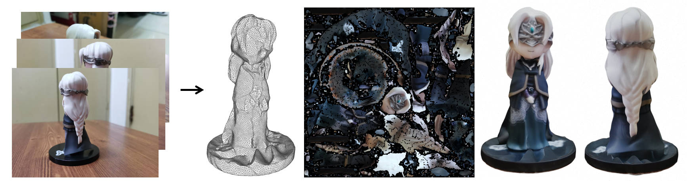
*Преобразование NeRF в текстурированный меш. Источник: [github.com/ashawkey/nerf2mesh](https://github.com/ashawkey/nerf2mesh)*

Итак, если говорить в общих чертах — в чём же на самом деле суть Gaussian Splats? Подведём итог:

Gaussian Splats — это техника рендеринга, растеризующая сохранённое поле излучения (или световое поле) в реалистичную сцену с произвольных ракурсов, обеспечивая хорошую производительность и визуальную достоверность, включая видозависимые эффекты. Обычно Gaussian Splats создаются по фотографиям, представляющим ограниченный набор ракурсов, в процессе обучения, использующем оптимизацию градиентным спуском — метод машинного обучения, похожий на тот, что применяется в нейросетях, — однако, в отличие от NeRF, Gaussian Splats не задействуют никаких нейронных сетей. Как правило, Gaussian Splats создаются/обучаются и рендерятся быстрее, чем NeRF, при сопоставимом качестве. По скорости создания и рендеринга они близки к моделям полигональной фотограмметрии с текстурами, но превосходят их по визуальному качеству на сложных органических сценах с видозависимым освещением.

## Введение в Gaussian Splats

Пожалуй, это хорошее место, чтобы завершить первую часть. В следующих частях мы подробнее поговорим о Gaussian Splats: о том, как их создавать, как оптимизировать, как рендерить, о видозависимом внешнем виде и сферических гармониках, о 2D- (и 4D-) сплатах, об инструментах, проектах, коде и библиотеках для работы с Gaussian Splats, а также о новых направлениях исследований.

**Обновление:** часть 2 уже опубликована: [«Creating Gaussian Splats: From Photos to a Trained Model»](https://alphapixeldev.com/gaussian-splats-part-2-creating-gaussian-splats/) (Создание Gaussian Splats: от фотографий к обученной модели).

AlphaPixel ежедневно решает сложные задачи для клиентов по всему миру. Мы разрабатываем ПО для компьютерной графики на всех уровнях — от встраиваемых и критически важных для безопасности драйверов до VR/AR/xR, плёноптических/голографических дисплеев, авионики и мобильных устройств, рабочих станций, кластеров и облака. Мы работаем в области компьютерной графики уже более 35 лет — работали на передовых компьютерах прошлого и даже были пионерами новых алгоритмов, техник, программного обеспечения и стандартов. Мы внесли вклад в многочисленные патенты, публикации и проекты. Наши наработки используются в открытых и закрытых кодовых базах по всему миру.

К нам обращаются, чтобы решить сложные задачи, которые люди не могут или не хотят решать самостоятельно. Если перед вами стоит сложная проблема и вы не уверены, что справитесь с ней сами, — обращайтесь к нам. We Solve Your Difficult Problems (Мы решаем ваши сложные задачи).
