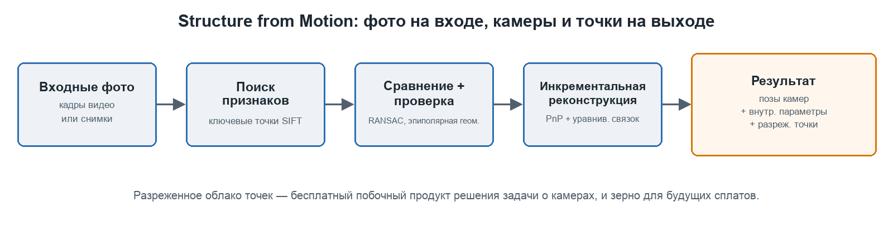
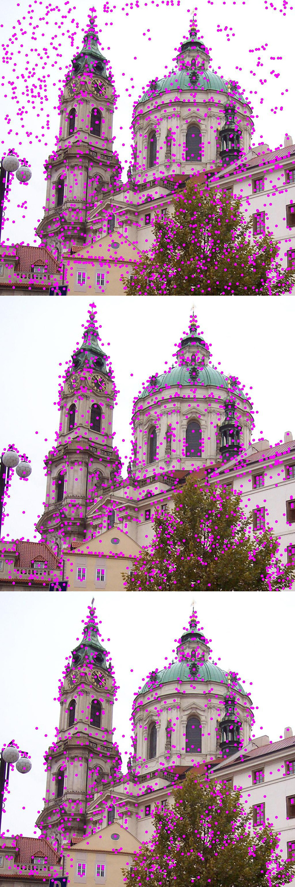
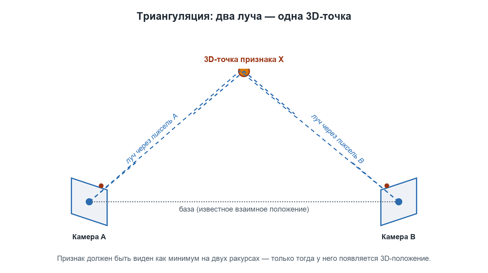
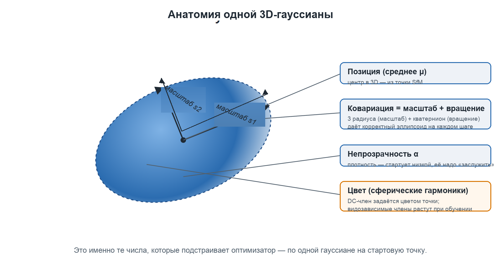
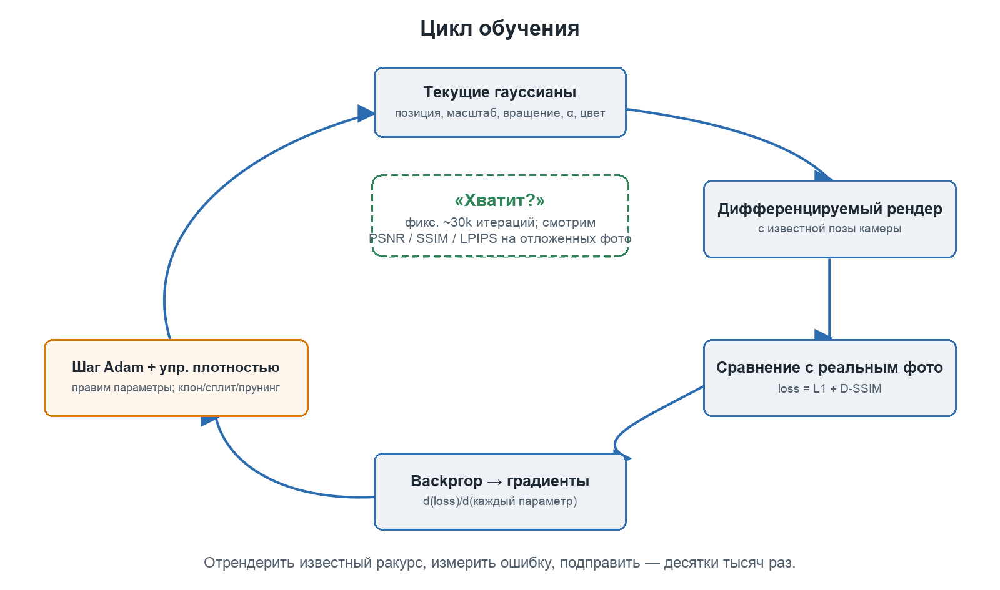
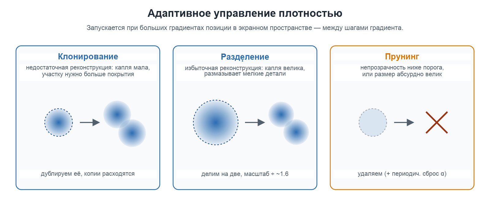
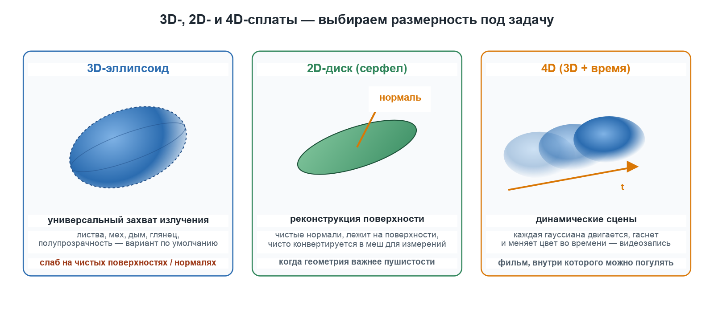

# Исчерпывающее введение и обзор Gaussian Splats. Часть 2 — Создание Gaussian Splats: от фотографий к обученной модели

Автор: Chris Hanson
Опубликовано 15 сентября 2026

В [первой части](https://alphapixeldev.com/a-comprehensive-introduction-and-overview-of-gaussian-splats-part-1-introduction/) мы разобрали термин по частям. Мы выяснили, что значит «сплат», что значит «гауссов», откуда вообще взялась эта техника (поля излучения, затем NeRF в 2020-м, затем статья INRIA о 3D Gaussian Splatting на SIGGRAPH 2023) и зачем её вообще понадобилось изобретать. Ответ в одно слово — скорость. NeRF заставляет нейросеть миллионы раз за кадр отвечать на вопрос «какого цвета и насколько яркий свет идёт из этой точки в этом направлении». Gaussian Splats заменяют это кучей размытых цветных эллипсоидов, которые можно прогнать через самый обычный GPU-растеризатор.

Часть 1 отвечала на вопрос «что». Эта часть — про «как».

Задача такая: у вас есть папка с фотографиями сцены — или видео, нарезанное на кадры. Вы хотите получить обученный набор гауссиан, воспроизводящий эту сцену с любого ракурса. Никто не даёт вам положения камер, никто не даёт готовую 3D-модель, а фотографии не поставляются с прикреплённой системой координат. Вы начинаете с пикселей, а заканчиваете несколькими миллионами маленьких светящихся капель, расположенных в 3D-пространстве. Этот пост — обо всём, что происходит между этими двумя точками.

Здесь два этапа, и обычно их выполняют две совершенно разные программы. Сначала вы восстанавливаете, где именно стояла каждая камера и через какой объектив она смотрела. Затем вы оптимизируете набор гауссиан до тех пор, пока рендер по ним не совпадёт с исходными фотографиями. Первый этап — старый, целиком позаимствованный из фотограмметрии. Второй этап — новая часть, и именно в нём кроется всё самое интересное.

## Сначала найдите камеры (он же COLMAP и компания)

Вот что люди обычно упускают из виду при первом знакомстве с Gaussian Splats. Гауссиана живёт в определённой позиции в 3D-пространстве. Чтобы оптимизировать эту позицию, сравнивая рендеры с фотографиями, нужно точно знать, где находилась камера в момент съёмки каждого кадра, куда она была направлена и как она проецировала мир на свой сенсор. Ничего из этого в самой фотографии не содержится. JPEG — это плоская сетка цветов. Вся 3D-информация была отброшена в тот момент, когда сработал затвор.

Поэтому прежде чем появится хоть один сплат, нужно восстановить положения камер по одним только фотографиям. Эта техника называется [Structure from Motion](https://en.wikipedia.org/wiki/Structure_from_motion), повсеместно сокращается как SfM и появилась на десятилетия раньше Gaussian Splats. Это та же самая математика, что строит разреженные облака точек в классической фотограмметрии, которую мы сравнивали со сплатами ещё в первой части. Для сплаттинга SfM — не опциональная приятная предобработка, а несущая конструкция. Ошибётесь здесь — и всё, что построено дальше, тоже незаметно окажется ошибочным.

### Поиск одинаковых признаковых точек на двух фотографиях

SfM начинается с поиска характерных небольших участков на каждом изображении. Не краёв, не плоских стен, а углов, пятен, текстур с узнаваемым локальным узором. Классический детектор — [SIFT (Scale-Invariant Feature Transform)](https://www.cs.ubc.ca/~lowe/papers/ijcv04.pdf), «масштабно-инвариантное преобразование признаков», и хотя сегодня существуют более новые обучаемые детекторы, SIFT и его родственники по-прежнему остаются рабочей лошадкой внутри большинства распространённых инструментов. Любопытно, что SIFT монохромен — оттенок и насыщенность цвета обычно отбрасываются.

Каждая ключевая точка (keypoint) получает дескриптор — вектор чисел, описывающий окружающие её пиксели так, чтобы это описание переживало поворот, изменение масштаба и умеренные изменения яркости. Именно в дескрипторе весь фокус. Благодаря ему можно взять угол подоконника, сфотографированный слева, и опознать его как тот же самый угол, сфотографированный справа, — даже если сами пиксели совершенно не похожи друг на друга.

*Ключевые точки SIFT, изображённые в виде векторов масштаба и ориентации. Автор: [Lukas Mach](https://commons.wikimedia.org/wiki/File:Sift_keypoints_filtering.jpg), лицензия [CC BY 3.0](https://creativecommons.org/licenses/by/3.0/).*

### Попарное сопоставление — и отбрасывание большей части результатов

Дальше дескрипторы сравниваются попарно между изображениями. Ключевая точка на изображении A, чей дескриптор очень близок к дескриптору точки на изображении B, — кандидат на совпадение. Проделайте это для каждой пары изображений (а для больших наборов — для «умного» подмножества пар, отобранного с помощью словарного дерева (vocabulary tree), чтобы не сравнивать все N² пар) — и вы получите гору кандидатов в соответствия.

Большинство из них ошибочны. Дескрипторы совпадают случайно, повторяющиеся текстуры обманывают всё подряд (кирпичные стены и штакетник — печально известные примеры), а отражения для этого процесса ядовиты (о них позже). Поэтому следующий шаг — геометрическая проверка. Для пары изображений все истинные совпадения должны быть согласованы с единым жёстким движением камеры. Это ограничение описывается [эпиполярной геометрией](https://en.wikipedia.org/wiki/Epipolar_geometry): фундаментальной матрицей, если калибровка ещё не известна, или существенной матрицей, если она уже есть. Точка на одном изображении обязана лежать на строго определённой линии на другом. Совпадения, нарушающие это условие, геометрически невозможны и отбрасываются.

Инструмент, который отделяет хорошие совпадения от мусора, — это [RANSAC (Random Sample Consensus)](https://en.wikipedia.org/wiki/Random_sample_consensus), «согласие по случайной выборке». Он раз за разом угадывает взаимное расположение камер по крошечному случайному подмножеству совпадений, проверяет, сколько из оставшихся совпадений согласуются с этой догадкой, и оставляет ту догадку, за которую «проголосовало» больше всего совпадений. Согласующиеся совпадения называются инлайерами (inliers), остальные отбрасываются. То, что делает RANSAC, звучит как случайный поиск — мы ещё вернёмся к этому сравнению позже. RANSAC — это устойчивый (робастный) оценщик именно для геометрического шага, а не метод оптимизации, обучающий сплаты. Это два разных процесса, и здесь легко запутаться.

### Триангуляция

Как только известно взаимное расположение двух камер, а также признак, который видели обе камеры, можно восстановить положение этого признака в 3D. Для этого из центра каждой камеры проводится луч через положение признака на её сенсоре. В идеальном мире два луча пересекаются ровно в одной точке пространства, и эта точка и есть искомый признак. В реальном мире они почти пересекаются, и берётся точка их наибольшего сближения. Именно из-за триангуляции точке нужно как минимум два ракурса, прежде чем у неё вообще может появиться 3D-положение.

### Инкрементальная реконструкция и уравнивание связок

Решить всю сцену сразу невозможно, поэтому стандартный подход строит её инкрементально (постепенно). Сначала выбирается удачная стартовая пара кадров — с широким базисом и большим числом совпадений. По ней восстанавливаются положения этих двух камер и триангулируются их общие точки. Затем ищется следующее изображение, на котором видна значительная часть уже имеющихся точек. Поскольку 3D-положения этих точек уже известны, а также известно, куда они спроецировались на новом изображении, можно вычислить положение новой камеры. Эта подзадача называется [Perspective-n-Point, PnP](https://en.wikipedia.org/wiki/Perspective-n-Point) (верный оруженосец [компьютерного зрения](https://alphapixeldev.com/computer-vision-development/)), и именно так каждая новая камера регистрируется в растущей реконструкции. Затем триангулируются новые точки, которые добавляет эта камера, — и всё повторяется. Повторяется до бесконечности.

Если бы всё сводилось только к этому, ошибки накапливались бы лавинообразно. У каждой триангулированной точки есть небольшая ошибка, у каждой зарегистрированной камеры есть небольшая ошибка, и при добавлении камер по одной эти ошибки постепенно «уплывают», пока дальний конец реконструкции не отклонится от реальности. Исправляется это [уравниванием связок](https://en.wikipedia.org/wiki/Bundle_adjustment) (bundle adjustment) — оно периодически запускается по мере роста реконструкции. Уравнивание связок — это большая нелинейная оптимизация методом наименьших квадратов, которая одновременно подстраивает позу каждой камеры и положение каждой 3D-точки, минимизируя суммарную ошибку репроекции: расстояние в пикселях между тем, куда каждая 3D-точка реально проецируется на каждом изображении, и тем, куда, по текущей оценке, она должна проецироваться. Это та же самая идея, что и в цикле обучения, который мы вот-вот построим для сплатов, только применённая к другому набору неизвестных. «Связка» (bundle) — это пучок лучей, сходящихся в центре каждой камеры, а цель — итеративно минимизировать ошибку согласования.

Когда всё завершено, у вас появляются три вещи, которых не было в начале, — и все они заданы в единой согласованной системе координат: поза каждой камеры (её внешние параметры, то есть положение и ориентация), калибровка камеры (её внутренние параметры) и *разреженное* облако 3D-точек. Это разреженное облако — бесплатный побочный продукт решения задачи о камерах, и именно оно становится зерном (seed) для будущих сплатов.

## Калибровка камеры не столько измеряется, сколько вычисляется

Внутренние параметры камеры заслуживают отдельного абзаца, потому что люди часто считают, будто камера их «просто знает». На деле это не так — по крайней мере, не настолько надёжно. Внутренние параметры — это фокусное расстояние (насколько объектив приближает изображение, в пикселях), главная точка (место, где оптическая ось попадает на сенсор — обычно рядом с центром, но не строго в нём) и дисторсия объектива (насколько объектив искривляет прямые линии — сильнее всего заметно по краям кадра на широкоугольных объективах и экшн-камерах).

Их *можно* инициализировать по [EXIF](https://en.wikipedia.org/wiki/Exif)-метаданным файлов изображений. EXIF часто содержит фокусное расстояние в миллиметрах и размер сенсора, а вместе они дают неплохую первую оценку фокусного расстояния в пикселях. Но EXIF может быть удалён редакторами, отсутствовать или быть неверным для обрезанных изображений — и он вообще ничего полезного не говорит о дисторсии. Поэтому конвейер не доверяет предоставленным внутренним параметрам и рассматривает их как неизвестные, которые предстоит восстановить. Это и есть самокалибровка: внутренние параметры уточняются прямо внутри уравнивания связок наряду со всем остальным, поскольку та же самая целевая функция ошибки репроекции чувствительна и к правильности фокусного расстояния с дисторсией. Изящно!

Есть одно полезное допущение, которое делает задачу разрешимой. Если все фотографии сделаны одной и той же физической камерой с фиксированным объективом, у них общий набор внутренних параметров. Вместо того чтобы решать задачу о фокусном расстоянии для каждого изображения независимо, можно решать её для одного фокусного расстояния, общего для всего набора, — а это намного лучше ограниченная задача. Распространённые инструменты позволяют группировать изображения по модели камеры и использовать общие внутренние параметры внутри группы.

Но если в процессе съёмки вы меняли зум, то у половины фотографий внутренние параметры будут отличаться от другой половины, и допущение об общих параметрах превращается в ложь (совсем как знаменитый «торт» — тоже ложь). Сенсоры с роллинг-шаттером (rolling shutter; большинство телефонов, большинство дронов) смазывают геометрию при быстром движении, потому что верх и низ кадра экспонируются в разные моменты времени, — из-за этого точечная модель камеры (pinhole model), которую подразумевают такие инструменты, оказывается немного неверной (это обычно важно только для кадров, извлечённых из видео с движения). А если вы подали на вход изображения, обрезанные или изменённые в размере уже после съёмки, главная точка и фокусное расстояние перестают соответствовать исходному сенсору — на практике старайтесь этого избегать.

## COLMAP и его родственники, и случай видео

Фактический стандартный инструмент для всего вышеперечисленного — [COLMAP](https://colmap.github.io/), open-source-пакет для SfM и Multi-View Stereo ([Schönberger и Frahm, CVPR 2016](https://openaccess.thecvf.com/content_cvpr_2016/papers/Schonberger_Structure-From-Motion_Revisited_CVPR_2016_paper.pdf)). Когда кто-то говорит «я прогнал через COLMAP», это значит, что он выполнил весь танец из детектирования признаков, сопоставления, проверки и инкрементальной реконструкции и получил на выходе позы камер плюс разреженное облако точек. [Оригинальный код 3DGS](https://github.com/graphdeco-inria/gaussian-splatting) ожидает на входе именно вывод COLMAP, и большая часть экосистемы до сих пор говорит на этом формате. Сегодня есть и более быстрые родственники — в частности, [GLOMAP](https://github.com/colmap/glomap) ([Pan et al., ECCV 2024](https://arxiv.org/abs/2407.20219)), который решает реконструкцию глобально, а не инкрементально, и работает значительно быстрее на больших наборах, — а также различные обучаемые «фронтенды», заменяющие этап SIFT-детектирования и сопоставления. Все они выдают один и тот же тип результата: позы, внутренние параметры, точки. К счастью, GLOMAP выдаёт файлы результатов в формате, совместимом с COLMAP, — их может использовать кто угодно.

Видео кое-что усложняет, а кое-что упрощает. Из упрощений: последовательные кадры видео уже упорядочены и лишь немного отличаются друг от друга, поэтому сопоставлять соседние кадры легко и надёжно. Из усложнений: видео даёт вам слишком много почти идентичных кадров, и обработка всех подряд — это впустую потраченная работа, которая может даже навредить, потому что тысячи пар с крошечным базисом почти не дают новой информации для триангуляции, зато сильно раздувают вычисления. Поэтому кадры прореживают: берут один кадр из каждых N, а лучше — берут кадры адаптивно, в зависимости от того, насколько сильно сдвинулась камера.

Более серьёзная проблема видео — смаз от движения (motion blur). На смазанном кадре признаковые точки тоже смазаны, а смазанные признаки плохо сопоставляются и ещё хуже триангулируются. Видео с рук и съёмка с дронов буквально кишат такими кадрами. Практичный ход — обнаружить и отбросить самые смазанные кадры ещё до начала обработки, а также снимать с короткой выдержкой, если у вас вообще есть контроль над съёмкой. Сотня чётких кадров лучше тысячи «мыльных». Это один из тех случаев, когда качество итогового сплата решается ещё до всякого сплаттинга — в момент съёмки, — и никакая хитрая оптимизация впоследствии не восстановит детали, которые изначально не были резкими в исходнике.

## От разреженного к плотному?

На этом этапе у вас есть разреженное облако точек. «Разреженное» — это буквально так и есть. Это лишь те признаковые точки, что пережили сопоставление и триангуляцию, — их от нескольких тысяч до, может быть, пары сотен тысяч, — и оно ПОЛНО дыр. Лишённые текстуры участки (голые стены, чистое небо, стекло) не дают признаков, а значит, не дают и точек. Если вы раньше занимались только классической фотограмметрией, инстинкт сейчас подсказывает: пора денсифицировать. («Люк, я твой Денсифай».)

Денсификация в фотограмметрическом смысле означает Multi-View Stereo, MVS («стерео с нескольких ракурсов»). После того как SfM выдал камеры, MVS возвращается к изображениям и для практически каждого пикселя пытается оценить глубину, сравнивая небольшие участки на всех ракурсах, где этот пиксель виден. COLMAP делает это с помощью PatchMatch-стерео с последующим этапом слияния (fusion), объединяющим карты глубины с каждого ракурса в одно плотное облако. Результат — на порядки больше точек, притом достаточно плотных, чтобы построить из них сплошную поверхность (меш), объединяя копланарные полигональные грани в более крупные плоские треугольники. Это классический фотограмметрический конвейер: разреженное облако → плотное облако → меш.

**Для Gaussian Splatting плотное облако не нужно.** Перечитайте это ещё раз. Gaussian Splatting НЕ нуждается в плотном облаке точек. Оригинальная работа по 3DGS инициализируется прямо по разреженным точкам SfM — и прекрасно работает. Более того, [в статье](https://arxiv.org/abs/2308.04079) показано, что даже инициализация случайным облаком точек, вообще без какой-либо структуры SfM (кроме поз камер), в итоге сходится к неплохому результату — просто медленнее и с несколько худшим качеством в редко покрытых областях. Оптимизация сама порождает детали по ходу работы, как мы увидим дальше, так что она не зависит от MVS в плане плотной стартовой геометрии. Запуск MVS перед сплаттингом — это по большей части впустую потраченное время, а хуже того, точки MVS несут собственные ошибки, которые вы тем самым «запекли» бы в модель как стартовое смещение. Это как печь пирог, подмешав камешков в начинку.

Так когда же всё-таки стоит запускать плотную реконструкцию? Есть три случая. Во-первых, если вам из той же съёмки нужен ещё и традиционный меш — для физики, коллизий, измерений или 3D-печати, то есть всего того, в чём, как мы говорили в первой части, сплаты слабы. Во-вторых, в некоторых гибридных конвейерах, преобразующих сплаты в меши (посмотрите на [MILo](https://github.com/Anttwo/MILo)), или использующих плотный априор для регуляризации геометрии, — в частности, в ориентированных на поверхность методах 2D-сплатов, до которых мы ещё дойдём. В-третьих, когда покрытие сцены фотографиями настолько скудное, что в разреженном облаке в каком-то участке почти ничего нет, и вы хотите дать оптимизатору там лучшую стартовую точку. В обычном же случае (много перекрывающихся фотографий, и вам нужен именно сплат и только сплат) — пропускайте MVS и инициализируйтесь прямо по разреженным точкам.

## Превращаем точки в стартовые гауссианы

Теперь начинается часть, специфичная именно для гауссиан. У вас есть позы камер и разреженное облако точек. Вы превращаете *каждую* точку в гауссиану.

Одна 3D-гауссиана определяется небольшой горсткой параметров. Разберём их.

- **Позиция (среднее, mean)**: где в 3D находится центр капли. Изначально инициализируется прямо по положению точки SfM.
- **Ковариация**: размер и форма эллипсоида. Вместо того чтобы хранить «сырую» матрицу ковариации 3×3, которая на каждом шаге оптимизации обязана оставаться положительно полуопределённой (иначе получится геометрическая бессмыслица), параметры разбиты на **масштаб** (scale; три числа — радиусы эллипсоида вдоль его собственных осей) и **вращение** ([кватернион](https://en.wikipedia.org/wiki/Quaternion), четыре числа, задающих ориентацию этих осей в пространстве). Ковариация при необходимости восстанавливается из них. Именно это разбиение гарантирует, что каждый шаг градиента порождает корректный эллипсоид. Изначально гауссиана инициализируется изотропной — маленьким круглым шариком (по сути, «толстой точкой»), — размер которого задаётся по расстоянию до ближайших соседних точек: так плотные области стартуют с маленьких гауссиан, а разреженные — с более крупных, чтобы адекватно покрыть и заполнить пространство.
- **Непрозрачность (opacity)**: насколько «плотна» капля — от прозрачной до полностью непрозрачной. Инициализируется низким значением, так что гауссианы стартуют едва заметными, и оптимизатору приходится «доказывать» необходимость их непрозрачности, показывая, что она действительно снижает метрику ошибки.
- **Цвет**, хранящийся в виде коэффициентов [сферических гармоник](https://en.wikipedia.org/wiki/Spherical_harmonics), — так цвет может меняться в зависимости от угла обзора. При инициализации задаётся только постоянный член (DC-компонента, то есть «плоский» средний цвет), взятый из цвета точки SfM. Члены более высоких порядков, отвечающие за видозависимое затенение, стартуют с нуля и «вырастают» в процессе обучения. Сферическим гармоникам будет посвящена отдельная часть этой серии; пока же достаточно знать, что цвет — это небольшая функция от направления взгляда, а не одно фиксированное значение RGB.

Итак, стартовая модель — это одна едва заметная, круглая, грубо окрашенная гауссиана на каждую точку SfM. Выглядит это ужасно, и так и должно быть. Всё хорошее происходит уже в итерациях цикла обучения.

## ~~Намылить, смыть, повторить~~ Рендер, сравнение, коррекция

В основе обучения лежит цикл, и концептуально он прост, хотя механизм внутри каждого шага — далеко не прост.

Берётся одна из исходных фотографий. Точная поза камеры для неё уже известна — её восстановил SfM. Текущий набор гауссиан рендерится именно с этой позы (по сути, в самом начале это просто разреженное облако точек SfM). Теперь у вас есть два изображения одинакового размера: рендер и исходная фотография. Они сравниваются попиксельно, и вычисляется метрика ошибки. Эта ошибка используется, чтобы чуть подтолкнуть параметры каждой гауссианы в направлении, которое заставит рендер больше походить на фотографию. Затем берётся другая фотография — и всё повторяется. Повторяется десятки тысяч раз.

Вот и весь цикл: отрендерить известный ракурс, измерить, насколько результат ошибочен, и чуть-чуть его подправить. Остальная часть этого поста — о том, как устроен каждый из этих трёх шагов, потому что «измерить, насколько ошибочен» и особенно «подправить» на самом деле выполняют здесь огромный объём работы.

### Метрика ошибки: по изображению и по сцене

Ошибка по изображению (per-image) сравнивает один рендер с одной фотографией. Функция потерь (loss) 3DGS — это смесь из двух слагаемых. Первое — обычная L1-потеря: среднее абсолютное отличие между соответствующими цветами пикселей. L1 проста и наказывает за то, что результат «чуть-чуть неправильный» везде. Второе — D-SSIM, производное от [индекса структурного сходства (SSIM)](https://en.wikipedia.org/wiki/Structural_similarity), которому важна локальная структура, контраст и текстура, а не сырое попиксельное различие цветов. SSIM ближе к тому, как человек замечает, похожи ли два изображения друг на друга; L1 же удерживает цвета «в рамках». В оригинальной статье их взвешивают коэффициентом лямбда около 0.2, так что итоговая потеря — это примерно 0.8×L1 плюс 0.2×структурное слагаемое. Эта конкретная пропорция — лишь одна из МНОЖЕСТВА настроек, которые крутят в разные стороны разные методы.

Каждая итерация обучения обычно работает с одной камерой за раз, выбранной случайным образом из набора, — чтобы оптимизатор не переобучился под тот порядок, в котором случайно оказались фотографии. Ошибка по всей сцене (scene-wide) — это просто потеря, усреднённая по *всем* обучающим ракурсам. За общесценовым числом следят, чтобы понять, прогрессирует ли обучение в целом; а число по конкретному изображению используется, чтобы сгенерировать поправки именно для *этого* ракурса.

### Когда результат «достаточно хорош», чтобы остановиться?

Люди обычно ожидают, что потеря достигнет какой-то цели и процесс объявит победу. На практике обычно всё не так. Обучение 3DGS на практике идёт фиксированное число итераций — как правило, около 30 000, — потому что кривая потерь продолжает медленно ползти вниз со всё убывающей отдачей, и чёткого порога, означающего «готово», почти никогда не бывает. Правилом остановки служит именно бюджет итераций, а сам бюджет подбирается из опыта работы с подобными сценами.

Тем не менее метрика ошибки совершенно точно показывает, насколько хорош результат в принципе. Правильный способ оценки — отложить часть фотографий, на которых оптимизатор вообще не обучался, отрендерить обученный сплат с этих отложенных поз камер и сравнить с реальными фотографиями, которые модель никогда не видела. Стандартные метрики — это [PSNR](https://en.wikipedia.org/wiki/Peak_signal-to-noise_ratio) (мера в децибелах, производная от попиксельной ошибки; чем выше, тем лучше), SSIM (структурное сходство; чем ближе к 1, тем лучше) и [LPIPS](https://arxiv.org/abs/1801.03924) (обучаемое перцептивное расстояние, хорошо коррелирующее с тем, что люди называют «выглядит правильно»; чем ниже, тем лучше). Если показатели на отложенных фото хорошие, значит, сплат обобщается на новые ракурсы, а не просто заучил обучающие фотографии наизусть. Если ошибка на обучающих ракурсах низкая, а на отложенных — высокая, налицо переобучение (overfitting), обычно из-за недостаточного покрытия сцены. Таким образом, метрика определяет два решения: продолжать ли итерации в рамках текущего запуска (редко, поскольку обычно всем заправляет бюджет итераций) и пригоден ли готовый сплат к использованию — или сцену нужно переснять [увы].

## Рендерер обязан быть дифференцируемым. А что вообще значит «дифференцируемый»?

Слово «подправить» (correct) в описании цикла скрывает за собой весь «секретный ингредиент» (все 11 трав и специй, да ещё и 23 вкуса впридачу) этой техники. Чтобы подтолкнуть параметры гауссианы в направлении, снижающем ошибку, нужно для каждого параметра знать, в какую сторону и насколько сильно его толкать. Эта информация — производная: насколько изменится итоговая ошибка по пикселям, если я чуть-чуть пошевелю вот это одно число. Получите такую производную для каждого параметра каждой гауссианы — и вы будете точно знать, как скорректировать всю модель одним согласованным шагом.

Это работает только в том случае, если рендер — гладкая, дифференцируемая функция от параметров. «Дифференцируемый» означает, что если изменить позицию гауссианы, её непрозрачность или одно из значений масштаба на бесконечно малую величину, то и итоговые пиксели изменятся на соответствующую бесконечно малую, вычислимую величину — без резких скачков. Рендерер с жёсткими краями — из тех, что решают, находится ли пиксель внутри треугольника или снаружи, — **НЕ** дифференцируем на этих краях: крошечное смещение переключает пиксель с одного цвета на другой без плавного перехода, а производная в критической точке попросту не определена. Через жёсткий край невозможно вычислить чистый градиент.

Гауссианы выбраны как раз потому, что они «мягкие». У гауссианы нет края. Её непрозрачность плавно спадает от центра до нуля, поэтому вклад пикселя от данной гауссианы — гладкая функция от её позиции, размера, ориентации и непрозрачности. Подтолкните любой из этих параметров — и пиксель изменится плавно. Эта мягкость, которую в первой части мы описывали как свойство «размытой капли», — не просто эстетический выбор ради красивых органических сцен. Это математическое свойство, которое и делает всю систему итеративно *обучаемой*.

[Дифференцируемый растеризатор, поставляемый вместе с 3DGS](https://github.com/graphdeco-inria/diff-gaussian-rasterization), делает следующее — и каждый его шаг построен так, чтобы для него можно было вычислить производную. Сначала он проецирует каждую 3D-гауссиану на изображение, превращая 3D-эллипсоид в 2D-эллипс на экране (эта проекция называется формулировкой EWA, Elliptical Weighted Average, «эллиптическое взвешенное усреднение», и включает линеаризацию, чей якобиан входит в путь градиента). Не переживайте, если многое из этого звучит как тарабарщина, — понимать это в деталях не обязательно, чтобы использовать или реализовать Gaussian Splats. Затем он сортирует гауссианы по глубине. После этого для каждого пикселя он проходит по гауссианам спереди назад и выполняет альфа-композитинг: каждая гауссиана вносит вклад в виде своего цвета, умноженного на её непрозрачность и на то, сколько света уже заблокировали более близкие гауссианы. Это накопление «спереди назад» — гладкая цепочка умножений и сложений, поэтому производная по каждому входному параметру задаётся известной формулой. Авторы реализации вручную вывели аналитические градиенты для позиции, масштаба, вращения, непрозрачности и коэффициентов сферических гармоник цвета, и именно этот вручную выведенный обратный проход во многом объясняет, почему оригинальный код такой быстрый. Он выполняется тайлами (tiled) на GPU, так что тысячи пикселей вычисляют свои градиенты параллельно.

## Backpropagation — это не название бойз-бэнда из 90-х

Как только известна ошибка на каждом пикселе и есть дифференцируемый путь от параметров к пикселям, этот путь можно пройти в обратную сторону. Начинаем с того, насколько ошибочен каждый пиксель. Цепное правило математического анализа позволяет распространить эту пиксельную ошибку обратно через альфа-композитинг, обратно через 2D-проекцию, обратно к каждому параметру каждой гауссианы, повлиявшей на этот пиксель. Результат — градиент: для каждого из миллионов параметров одно-единственное число, показывающее, в какую сторону и примерно насколько круто нужно двигаться, чтобы снизить ошибку. Это обратное распространение ошибки и есть в точности то, что означает термин [«backpropagation»](https://en.wikipedia.org/wiki/Backpropagation), — тот же самый механизм, что обучает нейросети, только применённый здесь к параметрам геометрии, а не к весам сети.

Затем делается шаг. В качестве оптимизатора используется [Adam](https://arxiv.org/abs/1412.6980): он отслеживает «скользящее» представление о недавних градиентах каждого параметра и адаптирует размер шага индивидуально для каждого параметра, так что параметры с устойчивыми градиентами двигаются уверенно, а «шумные» — осторожно. Разным типам параметров назначается разная базовая скорость обучения (learning rate), поскольку сдвиг позиции на 0.01 и сдвиг непрозрачности на 0.01 — это несопоставимые по масштабу изменения. Шаг сделан — и каждая гауссиана чуть сдвигается в сторону более точного воспроизведения фотографий. Затем рендерится следующий ракурс, и всё повторяется.

Именно в этом суть того, почему Gaussian Splatting вообще работает, и это прямой ответ на вопрос, который часто задают: а почему это не просто случайный перебор, бесцельно блуждающий целую вечность? Случайное блуждание (random walk) или метод Монте-Карло пробует изменения более-менее вслепую и оставляет те, что случайно помогли. При миллионах параметров слепой поиск безнадёжен — пространство слишком велико, чтобы случайно наткнуться на удачную конфигурацию. Градиентный спуск не гадает. Как истинный волшебник, он никогда не приходит раньше и никогда не опаздывает. На каждом шаге он вычисляет настоящее направление «вниз по склону» поверхности ошибки и уверенно движется вдоль него. Каждый параметр корректируется одновременно и целенаправленно, используя информацию, переданную дифференцируемым рендерером. Здесь есть доля случайности — на каждом шаге используется случайно выбранная камера, а не все сразу, — именно поэтому это технически [стохастический градиентный спуск](https://en.wikipedia.org/wiki/Stochastic_gradient_descent). Но направление каждого шага именно вычисляется, а не выбирается наугад. В этом разница между тем, чтобы «свести сцену в фокус» за тридцать тысяч осознанных шагов, и тем, чтобы никогда не добраться до цели случайным перебором. Дифференцируемый рендерер — это как раз то, что превращает «этот пиксель слишком красный» в «сдвинь вот эту конкретную гауссиану влево и снизь её непрозрачность», а это и делает задачу разрешимой.

## Адаптивное управление плотностью (Adaptive Density Control)

Градиентный спуск подстраивает параметры уже существующих гауссиан. Сам по себе он не может добавить гауссиану там, где сцене не хватает деталей, удалить ту, что не приносит никакой пользы, или разбить чрезмерно растянутую каплю на более мелкие части. Количество гауссиан и их грубое расположение — отдельная задача, которую решает набор эвристических правил, периодически запускаемых параллельно с шагами градиента. В оригинальной работе это называется Adaptive Density Control («адаптивное управление плотностью»), и понять этот механизм — значит понять, как несколько тысяч стартовых точек превращаются в несколько миллионов удачно расположенных гауссиан.

Триггером для добавления гауссиан служит градиент позиции в пространстве экрана (view-space positional gradient). Если гауссиана стабильно получает большой градиент по своей позиции в экранном пространстве, это значит, что оптимизатор постоянно пытается сдвинуть её, чтобы покрыть область, которую она одна адекватно представить не может. Это и есть сигнал о том, что участок сцены описан недостаточно. Реакция на этот сигнал зависит от размера самой гауссианы:

- **Клонирование (недостаточная реконструкция).** Участку требуется больше покрытия, но гауссиана там маленькая. Она дублируется — создаётся вторая гауссиана того же размера, — и обе постепенно «расходятся», чтобы покрыть область. Так модель разрастается в пустые области, которые нужно заполнить.
- **Разделение (split, избыточная реконструкция).** Участку требуется больше деталей, но гауссиана там крупная — одна большая капля пытается представить нечто с мелкой структурой. Она разбивается на две гауссианы меньшего размера, с уменьшением масштаба (в статье используется коэффициент около 1.6), а положения «дочерних» гауссиан задаются сэмплированием внутри объёма «родительской». Так добавляются мелкие детали там, где их размазывала одна грубая капля.
- **Прунинг (prune, отсечение).** Любая гауссиана, чья непрозрачность упала ниже небольшого порога, по сути ничего не привносит и удаляется. Гауссианы, разросшиеся до абсурдных размеров в мировых координатах или покрывающие слишком большую часть экрана, тоже отбраковываются, поскольку обычно являются артефактами. Прунинг не даёт модели разрастаться бесконечно и вычищает неудачные экземпляры.

Есть ещё один приём, который выглядит странно, пока не понимаешь, зачем он нужен: периодический сброс непрозрачности. Каждые несколько тысяч итераций непрозрачность всех гауссиан принудительно сбрасывается обратно к почти прозрачной. Гауссианы, которые действительно полезны, быстро восстанавливают свою непрозрачность через градиент; а гауссианы, которые просто болтались как едва заметный рудиментарный мусор, или «плавающие» артефакты рядом с камерами, которыми оптимизатор жульничал на нескольких пикселях, — не восстанавливаются и отсеиваются прунингом на следующем проходе. Это контролируемое «забывание», которое не даёт модели накапливать мусор, от которого иначе было бы не избавиться.

Адаптивная денсификация работает в течение среднего временного окна обучения (после начального «разогрева» и с остановкой задолго до конца), так что финальный отрезок обучения — это уже чистая доводка фиксированного набора гауссиан. Модель растёт, заполняется, обретает резкость — а затем «устаканивается».

## А затем их стало много

Описанное выше — это оригинальный рецепт INRIA. Он работает, это тот базовый вариант (baseline), на который все ссылаются, и в нём же явно виден простор для улучшений, которым индустрия и занимается с 2023 года. Правила о том, когда разделять, клонировать и отсекать гауссианы, — это эвристики, а эвристики как раз и есть та вещь, которую разные исследовательские группы настраивают по-разному в зависимости от того, что для них важнее: итоговое качество, скорость обучения или количество гауссиан (от которого зависят размер файла и стоимость рендеринга). Не превращая это в полноценный обзор литературы, вот несколько заметных направлений:

- **Более удачные триггеры денсификации.** Оригинальный метод использует среднюю величину градиента позиции, чтобы решить, что денсифицировать, — и систематически недостаточно денсифицирует некоторые участки. Методы семейства [AbsGS](https://arxiv.org/abs/2404.10484) и [Pixel-GS](https://arxiv.org/abs/2403.15530) меняют сам измеряемый сигнал — например, суммируют абсолютные значения градиентов или взвешивают их по тому, сколько пикселей покрывает гауссиана, — и восстанавливают детали, которые упускает базовый метод, не просто «закидывая» сцену дополнительными каплями.
- **Сглаживание (anti-aliasing).** Базовый метод рендерит гауссианы так, что при увеличении масштаба или изменении разрешения относительно обучающих ракурсов возникают алиасинг и «мерцание». [Mip-Splatting](https://arxiv.org/abs/2311.16493) добавляет 3D-фильтр сглаживания, ограничивающий, насколько мелкой может быть деталь гауссианы относительно того, с каким разрешением она была засэмплирована, плюс 2D-фильтр в экранном пространстве, — и результат держится при увеличении масштаба, вместо того чтобы рассыпаться на «крапинки».
- **Управление плотностью как принципиальное сэмплирование, а не набор эвристик.** Это прямой ответ на заданный ранее вопрос про Монте-Карло. [3DGS-MCMC](https://arxiv.org/abs/2404.09591) полностью переосмысливает всю историю с клонированием/разделением/прунингом, рассматривая набор гауссиан как выборку из некоторого распределения и заменяя вручную настроенные эвристики стратегией перемещения (relocation), выведенной из этого взгляда на задачу. Обратите внимание на иронию: явное применение подхода марковских цепей Монте-Карло (Markov Chain Monte Carlo, MCMC) к управлению плотностью делает процесс более дисциплинированным, а не более хаотичным, — ведь перемещение теперь выводится математически, а не угадывается. Такой подход, как правило, использует гауссианы эффективнее и меньше зависит от вороха порогов, которые нужно вручную задавать в оригинальном рецепте.
- **Скорость и бюджет.** [Taming 3DGS](https://arxiv.org/abs/2406.15643) и похожие работы вводят явное ограничение на число гауссиан и направляют денсификацию так, чтобы тратить этот бюджет там, где от него больше всего пользы, — благодаря этому можно обучаться быстрее и поставлять более компактную модель, немного жертвуя пиковым качеством ради существенной экономии вычислений и памяти.

Общая нить здесь такова: ядро из дифференцируемого рендеринга и обратного распространения ошибки стабильно и одинаково у всех, а меняется у этих методов именно окружающая его политика — когда добавлять геометрию, когда её убирать и как не допустить алиасинга. Если вы выбираете инструменты или направление исследований для своего проекта, рассуждать стоит именно вдоль этой оси: все согласны насчёт градиентного спуска через дифференцируемый растеризатор, и все расходятся во мнениях насчёт правил управления плотностью, навешанных вокруг него.

## 3D-, 2D- и 4D-сплаты: разве больше D не значит лучше?

До сих пор мы описывали 3D-гауссианы — полноценные эллипсоиды, расположенные в пространстве. Это универсальная форма, которую вы по умолчанию и будете использовать. Но размерность — это осознанный выбор проектирования, и два важных варианта сознательно её меняют.

**3D-гауссианы** — это объёмные («волюметрические») капли. Это подходящий инструмент для захвата излучения в общем случае, особенно для тех органических, видозависимых сцен, которые мы хвалили в первой части: листва, мех, дым, глянцевые и полупрозрачные материалы — всё, где понятие единой твёрдой поверхности перестаёт работать. Их слабость — как раз в их объёмности: у облака эллипсоидов нет чётко определённой поверхности, поэтому извлечь из 3D-сплата чистую геометрию или точные нормали сложно, а сами эллипсоиды могут слегка «плавать» рядом с настоящей поверхностью — незаметно на рендере, но фатально для любой попытки построить по ним меш.

**2D-гауссианы** (техника, которую обычно обозначают 2DGS, из работы 2024 года о [2D Gaussian Splatting](https://arxiv.org/abs/2403.17888)) сплющивают каждый примитив в диск — ориентированный плоский сплат без толщины, так называемый серфел (surfel). Звучит как шаг назад, и для чистого качества изображения на «пушистых» сценах иногда так оно и есть. Но плоский диск ложится на поверхность так, как толстый эллипсоид не может, и у него есть однозначная нормаль — направление, куда он «смотрит». Именно поэтому 2D-сплаты намного лучше, когда истинная цель — это поверхность: точная реконструкция геометрии, извлечение чистых мешей, получение нормалей, достаточно хороших для перерасчёта освещения (relighting). Если нужен сплат, который впоследствии можно превратить в пригодный для измерений или симуляции меш, 2D-сплаты обычно оказываются лучшей стартовой точкой, — и это как раз один из упомянутых ранее случаев, когда ориентированный на поверхность конвейер выигрывает от плотного геометрического «наставника» (dense geometric supervision).

**[4D-гауссианы](https://arxiv.org/abs/2310.08528)** добавляют время как четвёртую ось. 3D-сплат замораживает один-единственный момент в 3D — совсем как Bullet Time из «Матрицы»; 4D-сплат же представляет, как сцена меняется на протяжении последовательности кадров, так что каждая гауссиана может со временем двигаться, вращаться, расти, угасать и менять цвет. Именно это нужно для динамических сцен: человек в движении, флаг на ветру — всё, что снято как видео, а не как статичный набор фотографий неподвижного объекта. Цена — больше параметров, более строгая дисциплина съёмки (как правило, нужно много синхронизированных ракурсов одновременно, а не одна камера, гуляющая вокруг объекта, — ведь объект не будет стоять смирно, пока вы обходите его кругом), и более тяжёлое обучение. Но это единственный способ получить воспроизведение с произвольного ракурса чего-то, что действительно двигалось. 3D-сплаты — это фотография, внутри которой можно погулять. 4D-сплаты — это *фильм*, внутри которого можно погулять.

Эмпирическое правило: 3D — для статичной сцены, которая должна хорошо выглядеть с любого угла; 2D — когда поверхность и геометрия важнее «пушистости»; 4D — когда объект движется.

## Сплат — и дело в шляпе

Итак, вот и весь путь от папки с фотографиями до обученного сплата. SfM (обычно COLMAP/GLOMAP) восстанавливает камеры и разреженное облако точек, попутно незаметно самокалибруя объективы. Плотный этап MVS, который запустила бы классическая фотограмметрия, вы пропускаете — если только вам не нужен ещё и меш. Каждая разреженная точка становится едва заметной стартовой гауссианой. Затем цикл обучения рендерит каждый известный ракурс через дифференцируемый растеризатор, измеряет ошибку относительно реальной фотографии смесью из L1 и структурной потери, распространяет эту ошибку обратно в градиент для каждого параметра и сдвигает каждую гауссиану «вниз по склону» с помощью Adam — осознанно, а не случайно. Adaptive Density Control клонирует, разделяет и отсекает гауссианы между шагами градиента, чтобы модель наращивала детали там, где того требует сцена, и избавлялась от того, что не используется. Прогоните это десятки тысяч итераций — и куча капель складывается в сцену.

Две вещи, которые мы сознательно отложили на потом, — это ровно то, чем мы займёмся дальше. Мы то и дело повторяли, что цвет — это небольшая функция от направления взгляда, и махали рукой в сторону сферических гармоник; это и будет следующая часть — о видозависимом внешнем виде, — именно она объясняет, почему отражения и блики на сплате следят за вашим взглядом так же, как это делает настоящая поверхность. А после неё, возможно, мы построим и сам runtime-рендерер — часть, которая берёт готовый сплат и рисует его в реальном времени в браузере или игровом движке, что уже совсем другая задача, нежели его обучение.

Мы уже 35 лет занимаемся компьютерной графикой, а в последнее время — во многом конвейерами превращения изображений в 3D для VFX, ГИС и криминалистики (forensics); именно из этой работы по [компьютерному зрению](https://alphapixeldev.com/computer-vision-development/) и выросла данная серия статей. Если у вас есть съёмка, которая никак не сходится, сплат, который нужно силой встроить в конвейер, изначально для этого не предназначенный, или направление исследований, которое хочется оценить прежде, чем вкладывать в него реальный бюджет, — это как раз тот тип сложных задач, которые мы решаем. [Расскажите, над чем вы работаете](https://alphapixeldev.com/contact/), и мы честно скажем, подходят ли здесь сплаты.

---

### Источники и дополнительное чтение

Иллюстрации в этом посте — оригинальные диаграммы, их можно свободно использовать повторно. Основные источники всего вышеизложенного, в порядке упоминания:

- Kerbl, Kopanas, Leimkühler, Drettakis. *3D Gaussian Splatting for Real-Time Radiance Field Rendering*, SIGGRAPH 2023. [Project page](https://repo-sam.inria.fr/fungraph/3d-gaussian-splatting/) · [arXiv:2308.04079](https://arxiv.org/abs/2308.04079) · [code](https://github.com/graphdeco-inria/gaussian-splatting) · [differentiable rasterizer](https://github.com/graphdeco-inria/diff-gaussian-rasterization)
- Mildenhall et al. *NeRF: Representing Scenes as Neural Radiance Fields for View Synthesis*, ECCV 2020. [arXiv:2003.08934](https://arxiv.org/abs/2003.08934)
- Schönberger, Frahm. *Structure-from-Motion Revisited* (COLMAP), CVPR 2016. [Paper](https://openaccess.thecvf.com/content_cvpr_2016/papers/Schonberger_Structure-From-Motion_Revisited_CVPR_2016_paper.pdf) · [colmap.github.io](https://colmap.github.io/)
- Pan et al. *Global Structure-from-Motion Revisited* (GLOMAP), ECCV 2024. [arXiv:2407.20219](https://arxiv.org/abs/2407.20219) · [code](https://github.com/colmap/glomap)
- Lowe. *Distinctive Image Features from Scale-Invariant Keypoints* (SIFT), IJCV 2004. [Paper (PDF)](https://www.cs.ubc.ca/~lowe/papers/ijcv04.pdf)
- Wang, Bovik, Sheikh, Simoncelli. *Image Quality Assessment: From Error Visibility to Structural Similarity* (SSIM), IEEE TIP 2004. [Overview](https://en.wikipedia.org/wiki/Structural_similarity)
- Zhang et al. *The Unreasonable Effectiveness of Deep Features as a Perceptual Metric* (LPIPS), CVPR 2018. [arXiv:1801.03924](https://arxiv.org/abs/1801.03924)
- Kingma, Ba. *Adam: A Method for Stochastic Optimization*, ICLR 2015. [arXiv:1412.6980](https://arxiv.org/abs/1412.6980)
- Ye et al. *AbsGS: Recovering Fine Details for 3D Gaussian Splatting*, ACM MM 2024. [arXiv:2404.10484](https://arxiv.org/abs/2404.10484) · [code](https://github.com/TY424/AbsGS)
- Zhang et al. *Pixel-GS: Density Control with Pixel-aware Gradient*, ECCV 2024. [arXiv:2403.15530](https://arxiv.org/abs/2403.15530)
- Yu et al. *Mip-Splatting: Alias-free 3D Gaussian Splatting*, CVPR 2024. [arXiv:2311.16493](https://arxiv.org/abs/2311.16493)
- Kheradmand et al. *3D Gaussian Splatting as Markov Chain Monte Carlo*, NeurIPS 2024. [Project page](https://3dgs-mcmc.github.io/) · [arXiv:2404.09591](https://arxiv.org/abs/2404.09591)
- Mallick, Goel et al. *Taming 3DGS: High-Quality Radiance Fields with Limited Resources*, SIGGRAPH Asia 2024. [arXiv:2406.15643](https://arxiv.org/abs/2406.15643)
- Huang et al. *2D Gaussian Splatting for Geometrically Accurate Radiance Fields*, SIGGRAPH 2024. [arXiv:2403.17888](https://arxiv.org/abs/2403.17888)
- Wu et al. *4D Gaussian Splatting for Real-Time Dynamic Scene Rendering*, CVPR 2024. [Project page](https://guanjunwu.github.io/4dgs/) · [arXiv:2310.08528](https://arxiv.org/abs/2310.08528)
