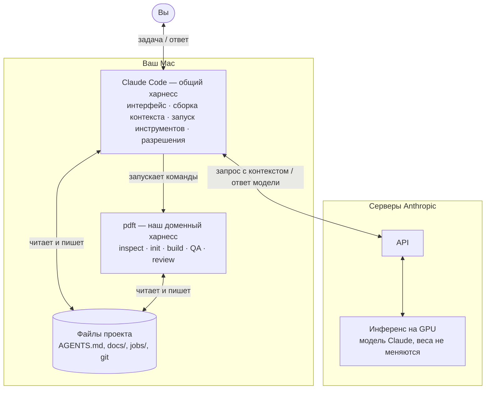
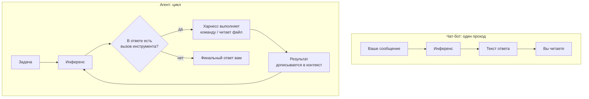
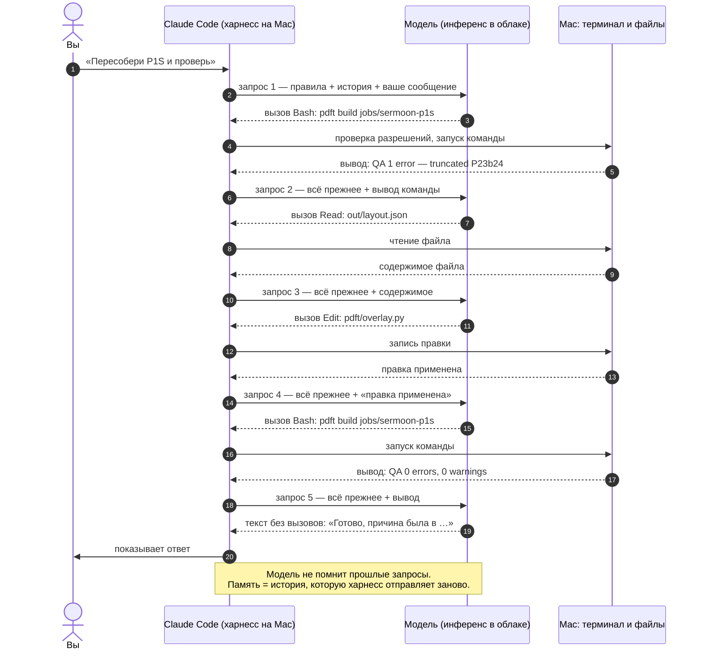
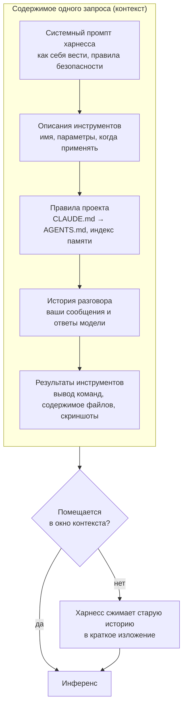
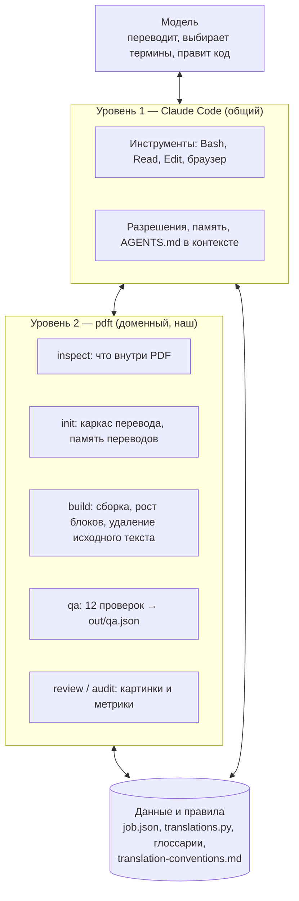
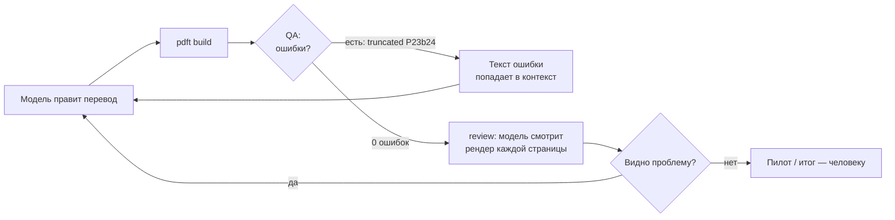

# Как ИИ-агент работает с харнессом

Шпаргалка о том, что происходит, когда Claude Code (или Codex) работает над этим проектом. Всё сказанное подходит для любого харнесса, не только для перевода PDF.

## Три разные вещи

| | Что это | Где работает | Пример |
|---|---|---|---|
| **Модель** | нейросеть: по тексту на входе предсказывает следующий кусочек текста (токен); знания «зашиты» в веса при обучении и дальше не меняются | серверы Anthropic / OpenAI | Claude Opus, GPT |
| **Инференс** | один запуск модели: прогнать входной текст через веса и сгенерировать ответ, токен за токеном | там же, на GPU | один запрос к API |
| **Харнесс** | программа вокруг модели: собирает вход, отправляет запрос, выполняет то, что модель попросила, возвращает результат, хранит правила и память | у вас на компьютере | Claude Code desktop/CLI, Codex CLI, наш `pdft` |

Claude Code desktop — **не инференс, а харнесс**. Инференс происходит на серверах; приложение на Mac только готовит запросы и выполняет действия.

## Где что находится

Модель **ничего не исполняет сама** и не видит ваш диск. Она только пишет текст особого формата: «вызови `Bash` с такой командой». Выполняет его харнесс.

## Чат-бот и агент

| | Чат-бот | Агент + харнесс |
|---|---|---|
| Что может | только написать текст | читать и менять файлы, запускать программы, смотреть картинки |
| Откуда берёт факты | из весов (на дату обучения) и из того, что вы вставили | ещё и из среды: файлы, вывод команд, результаты проверок |
| Знает ли, что ошибся | нет | да, если среда даёт сигнал: ошибка, тест, QA |
| Длинные задачи | теряет нить | ведёт состояние в файлах и git |
| Модель | та же | та же — разница только в цикле и среде |

## Один ход агента изнутри

Реальный эпизод этого проекта: перевод пропал под QR-кодом, проверка это поймала. Каждая пара «запрос → ответ» — **отдельный инференс**, и каждый раз модели заново отправляется вся история.

Один ответ, который вы видите в чате, — это обычно десятки инференсов.

## Что модель «видит» в каждом запросе

Из этого следуют правила хорошего харнесса:

- **Файл попадает к модели, только если она его прочитала.** Прочитанный файл занимает место в окне, поэтому `AGENTS.md` короткий, а подробности лежат в `docs/` и читаются по ссылке.
- **Об инструменте модель знает только из его описания.** Плохое описание — инструмент не используется или используется неправильно.
- **Всё, что должно пережить сессию, хранится в файлах**, а не в разговоре.

## Где живёт память

| Слой | Что хранит | Как долго | В этом проекте |
|---|---|---|---|
| Веса модели | общие знания: язык, программирование, PDF | до следующей версии модели | не управляем |
| Контекст | текущий разговор и прочитанное | до конца сессии (или до сжатия) | ход работы над мануалом |
| Файлы и git | правила, решения, данные, история | постоянно | `AGENTS.md`, `docs/`, глоссарии, `NOTES.md`, `translations.py`, память переводов |

Новая сессия начинается «с нуля», кроме того, что харнесс подложит из файлов. Поэтому у нас правила и решения записаны в репозитории: агент без контекста получает их автоматически.

## Два уровня харнесса в этом проекте

Claude Code даёт модели «руки» вообще. `pdft` превращает перевод мануала в набор команд с понятным результатом и сигналом «готово / не готово».

## Как агент узнаёт, что ошибся

Модель одинаково уверенно пишет правильное и неправильное. Отличить одно от другого может только сигнал из среды.

Чем больше проверок превращает «хорошо ли получилось» в текст, который модель прочитает, тем меньше работы остаётся человеку.

## Принципы для любого харнесса

1. **Механическое — коду, суждение — модели.** Вёрстка, подсчёты, проверки — детерминированный код. Перевод, выбор термина, решение по неоднозначному случаю — модель.
2. **«Готово» должно быть измеримым.** «0 ошибок QA», «тесты зелёные», а не «выглядит хорошо».
3. **Состояние — в файлах.** Разговор забудется, файлы останутся.
4. **Короткие правила и ссылки на подробности.** Контекст — ограниченный ресурс.
5. **Ограничения — в коде.** Правило «не перезаписывай `blocks.json`» в тексте можно нарушить; `--force` в коде — нельзя.
6. **Каждая повторяющаяся правка человека — в правило, данные или проверку.**

## Словарь

| Термин | Значение |
|---|---|
| Токен | кусочек текста (часть слова), с которым работает модель; длина контекста и цена считаются в токенах |
| Контекст / окно контекста | весь текст, который модель видит в одном запросе, и его предел |
| Системный промпт | инструкции, которые харнесс кладёт в начало каждого запроса |
| Инструмент (tool) | действие, которое харнесс умеет выполнять по просьбе модели |
| Вызов инструмента (tool call) | структурированный ответ модели «выполни X с параметрами Y» |
| Агент | модель в цикле «подумать → вызвать инструмент → получить результат» |
| Харнесс | всё вокруг модели: сборка контекста, инструменты, разрешения, правила, память, проверки |
| Сжатие (компакция) | замена старой истории кратким изложением, когда окно переполняется |
